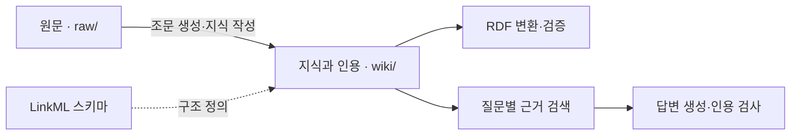

# Korean Employment Ontology

A source-traceable ontology of Korean employment law, starting with worker separation and unemployment benefits.

근로자의 이직부터 실업급여 지급까지 요건, 계산 규칙, 절차, 증빙을 법령의 조·항·호와 시행 시점에 연결한다. 사업주의 신고 의무, 피보험자격, 취업촉진 수당과 연장급여도 다룬다. 이 온톨로지를 근거로 노동법 상담 질문에 답하는 챗봇을 함께 만든다.

## Demo

<https://github.com/user-attachments/assets/2c39a92c-2c16-4051-8402-d00298c80bdd>

일용근로자의 구직급여 하루 상한액을 묻는 같은 질문에 대해, [고용노동부 AI 노동법 상담](https://ai.moel.go.kr/)의 응답과 적용 규정으로 계산한 결과를 비교한다.

> 2026년 9월 30일 퇴사한 일용근로자입니다. 하루 8시간 일했는데 구직급여는 하루 최대 얼마인가요?

| 이직일 | AI 노동법 상담 응답 | 적용 규정에 따른 상한액 |
| --- | ---: | ---: |
| 2026-09-30 | 66,000원 | 68,100원 |
| 2025-12-31 | 66,000원 | 66,000원 |

2026-01-01부터 고용보험법 시행령 제68조제1항의 기초일액 상한은 113,500원이고, 법 제46조제1항제1호의 지급 비율 60%를 곱하면 68,100원이다. 부칙 제35934호 제4조는 시행 전 이직자에게 종전 규정을 적용한다. [1350 상담 안내](https://1350.moel.go.kr/rtmview.do?id=1000324861)도 두 상한액과 적용 시점을 밝힌다. 응답은 2026-11-09에 수집했고, 두 질문으로 서비스 전체의 정확도를 평가하지 않는다. [수집 기록](view/README.md#비교-응답)

## Data and schema

| 자료 | 수집 경로 |
| --- | --- |
| 법률·시행령·시행규칙 | 법제처 공동활용 API |
| 행정규칙 | 법제처 공동활용 API |
| 대법원 판례, 법령해석례 | 법제처 공동활용 API |
| 고용24 안내 | 안내 웹페이지 |

현행·시행예정 원문과, 경과조치 판단에 필요한 과거 버전을 보존한다. [수집 목록](scripts/sources.yaml) · [기준일과 경과 기간](ontology/release.yaml)

공공서비스는 CPSV-AP 3.2.0, 요건·증빙은 CCCEV 2.1.0, 법령과 버전은 ELI 1.4로 모델링한다. 개념 분류는 SKOS, 출처는 PROV-O로 표현하며, 클래스와 속성은 [LinkML 스키마](ontology/schema.yaml)에 정의한다. [스키마 문서](ontology/schema.md)

## Architecture



원문·지식·스키마를 나눈 [LLM Wiki](https://gist.github.com/karpathy/442a6bf555914893e9891c11519de94f) 방식이다. 법령 조문 노트는 스크립트가 원문에서 생성하고, LLM은 원문을 인용해 지식과 관계를 쓰며, 별도 검증 에이전트가 대조한다. [운영 규칙](AGENTS.md) · [구현 구조](docs/implementation.md)

## Quick start

Python 3.12 이상과 [uv](https://docs.astral.sh/uv/)가 필요하다.

```sh
git clone https://github.com/utact/kr-employment-ontology.git
cd kr-employment-ontology
uv sync --frozen
```

질문에 답하려면 `.env.example`을 `.env`로 복사하고 언어 모델 설정을 채운다. `--as-of`는 상담 기준일이며, 그날 시행 중인 조문을 근거로 쓴다.

```sh
uv run python -X utf8 scripts/ask.py answer "2025년 12월 31일에 퇴사한 일용근로자의 구직급여 하루 상한액은?" --as-of 2026-01-15 --provider nvidia --format text
```

예제 화면은 `uv run python -X utf8 view/serve.py`로 열고 <http://127.0.0.1:8765/view/>에서 본다. [화면 설명](view/README.md)

검사는 다음 명령으로 실행한다. 원문을 다시 수집하려면 `.env`에 `LAW_OC`가 필요하다.

```sh
uv run python -X utf8 scripts/lint.py
uv run python -X utf8 scripts/cq.py
uv run python -X utf8 scripts/coverage.py
uv run python -X utf8 -m pytest
```

## License

코드는 [MIT License](LICENSE)를 따른다. 수집 원문, 표준과 시각 자산의 이용 조건은 각 출처 표기를 따른다. [표준 출처](ontology/shapes/README.md) · [시각 자산 출처](view/README.md#심벌)
