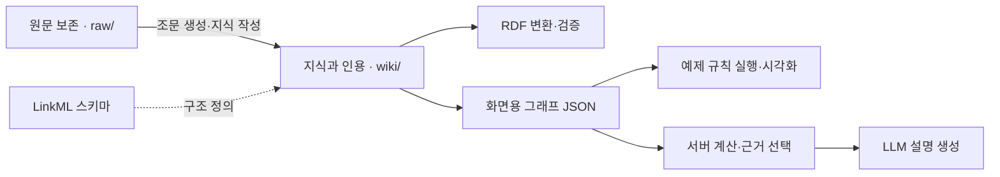

# Korean Employment Ontology

A source-traceable ontology of Korean employment law, starting with worker separation and unemployment benefits.

근로자의 이직부터 실업급여 지급까지, 요건·계산 규칙·절차·증빙을 법령 원문의 조·항·호와 적용 시점에 연결한다. 사업주의 신고 의무, 피보험자격, 취업촉진 수당과 연장급여도 포함한다.

노드 1,371개 · 관계 7,898개 · 법령 기준일 2026-10-14

## Demo

<https://github.com/user-attachments/assets/2c39a92c-2c16-4051-8402-d00298c80bdd>

예제 01은 일용근로자의 구직급여 하루 상한액을 다룬다. 같은 질문에 대한 [고용노동부 AI 노동법 상담](https://ai.moel.go.kr/)의 실제 응답과, 적용 규정으로 계산한 결과를 비교한다.

> 2026년 9월 30일 퇴사한 일용근로자입니다. 하루 8시간 일했는데 구직급여는 하루 최대 얼마인가요?

| 이직일 | AI 노동법 상담 응답¹ | 적용 규정에 따른 상한액 |
| --- | ---: | ---: |
| 2026-09-30 | 66,000원 | 68,100원 |
| 2025-12-31 | 66,000원 | 66,000원 |

2026-01-01 시행된 고용보험법 시행령 제68조제1항의 기초일액 상한 113,500원에 법 제46조제1항제1호의 지급 비율 60%를 적용하면 68,100원이다. 부칙 제35934호 제4조는 시행 전 이직자에게 종전 규정을 적용한다. [고용노동부 1350 상담 안내](https://1350.moel.go.kr/rtmview.do?id=1000324861)에서도 두 상한액과 적용 시점을 확인할 수 있다.

¹ 2026-11-09에 수집한 응답이다. 비교 화면은 그 응답을 관측 시점대로 표시하며, 온톨로지 기반 설명은 NVIDIA API로 생성한다. 두 질문의 관측 결과로 전체 상담 정확도나 응답 속도의 우열을 평가하지 않는다. [수집 기록과 실행 방식](view/README.md#실제-비교-응답)

## Data & Schema

| 자료 | 규모 | 수집 경로 |
| --- | ---: | --- |
| 법률·시행령·시행규칙 | 핵심 6개 + 참조 13개 | 법제처 공동활용 API |
| 행정규칙 | 19종 | 법제처 공동활용 API |
| 대법원 판례 | 8건 | 법제처 공동활용 API |
| 법령해석례 | 10건 | 법제처 공동활용 API |
| 고용24 안내 | 3쪽 | 안내 웹페이지 |

현행·시행예정 원문과, 핵심 법령·행정규칙의 경과조치 판단에 필요한 과거 버전을 보존한다. 고용24 안내는 이용 절차 구성과 법령 대조에 사용한다. [수집 목록](scripts/sources.yaml) · [기준일과 경과 기간](ontology/release.yaml)

공공서비스는 CPSV-AP 3.2.0, 요건·증빙은 CCCEV 2.1.0, 법령과 버전은 ELI 1.4를 기반으로 모델링한다. 개념 분류에는 SKOS, 출처 표현에는 PROV-O를 사용하며, 클래스와 속성은 [LinkML 스키마](ontology/schema.yaml)에 정의한다. [스키마와 표준 적용 범위](ontology/schema.md)

## Architecture



원문·지식·스키마를 분리한 [LLM Wiki](https://gist.github.com/karpathy/442a6bf555914893e9891c11519de94f) 방식이다. 법령 조문은 스크립트가 생성하고, LLM은 원문을 인용해 지식과 관계를 작성한다. Ingest는 자료의 지식 반영, Query는 근거를 연결한 질의, Lint는 인용·수치·날짜·관계·구조의 검사이다. [운영 규칙](CLAUDE.md#operations)

웹은 위키에서 내보낸 JSON을 사용한다. 현재 예제는 이직일에 따라 규정과 계산을 선택하고, 서버가 계산 결과와 법령 발췌 4개를 LLM에 전달한다. 언어 모델이 반환한 금액과 근거 ID를 검사한 뒤 설명을 표시한다. 그래프의 포커싱과 빛 이동은 이 규칙 실행과 사용 근거를 시각화한다. [구현 구조](docs/implementation.md)

## Validation

| 검사 | 확인 결과 |
| --- | --- |
| 지정 범위 조문 인용 | 171/171개 |
| SPARQL 역량 질문 | 24개 검사, 문제 0건 |
| 구조 | LinkML·자체 SHACL·CPSV-AP/CCCEV 공식 SHACL 검사 |

공식 SHACL 검사에는 스키마에 문서화한 예외가 있다. [표준 적용과 검증의 범위](docs/implementation.md#검증의-범위)

작성과 검증 에이전트를 분리하고, 지식 내용과 인용 블록의 해시 및 생성기 커밋 또는 검증 모델 정보를 [검증 원장](ontology/verification.jsonl)에 기록한다. 조문 인용률과 역량 질문 검사는 지정된 지식 범위에 대한 검사이다. [역량 질문과 기대 답](docs/competency-questions.md)

## Quick Start

Python 3.12 이상과 [uv](https://docs.astral.sh/uv/)가 필요하다.

```sh
git clone https://github.com/utact/kr-employment-ontology.git
cd kr-employment-ontology
uv sync --frozen
uv run python -X utf8 view/serve.py
```

[http://127.0.0.1:8765/view/](http://127.0.0.1:8765/view/)에서 그래프를 열 수 있다. 답변을 생성하려면 `.env.example`을 `.env`로 복사하고 `NVIDIA_API_KEY`를 설정한다. 원문을 다시 수집할 때는 `LAW_OC`가 필요하다. [언어 모델 설정](view/README.md#모델)

```sh
uv run python -X utf8 scripts/cq.py
uv run python -X utf8 scripts/coverage.py
uv run python -X utf8 scripts/lint.py
uv run python -X utf8 scripts/export_view.py --check
```

역량 질문과 조문 인용 검사는 수집 API 키 없이 실행할 수 있다. 저장소 전체 Lint의 원문 재생성 검사에는 과거 버전의 로컬 캐시가 필요할 수 있다. [검사 재현 조건](docs/implementation.md#재현)

## Status & Roadmap

| 구분 | 내용 |
| --- | --- |
| 구현 기능 | 지식 그래프 탐색, 이직일에 따른 구직급여 상한액 비교, 법령 근거를 연결한 답변 생성 |
| 개발 계획 | 자유질문, 질문별 근거 검색과 탐색 기록 생성, 상용근로자·사업주 예제 |
| 검토 과제 | 심사·재심사 세부 절차, 복수 피보험자격 특례, 예술인·노무제공자의 일부 절차와 미해결 해석 |

현재 웹은 정해진 예제의 규칙을 실행한다. 자유질문이나 LLM의 자율 그래프 탐색은 구현하지 않았다. 데이터 기준일 이후의 개정을 자동 반영하는 상시 갱신 서비스도 운영하지 않는다. [검증 후속 검토](docs/verification-followups.md)

## License

코드는 [MIT License](LICENSE)를 따른다. 수집 원문, 표준과 시각 자산의 이용 조건은 각 출처 표기를 따른다. [표준 출처](ontology/shapes/README.md) · [시각 자산 출처](view/README.md#심벌)
